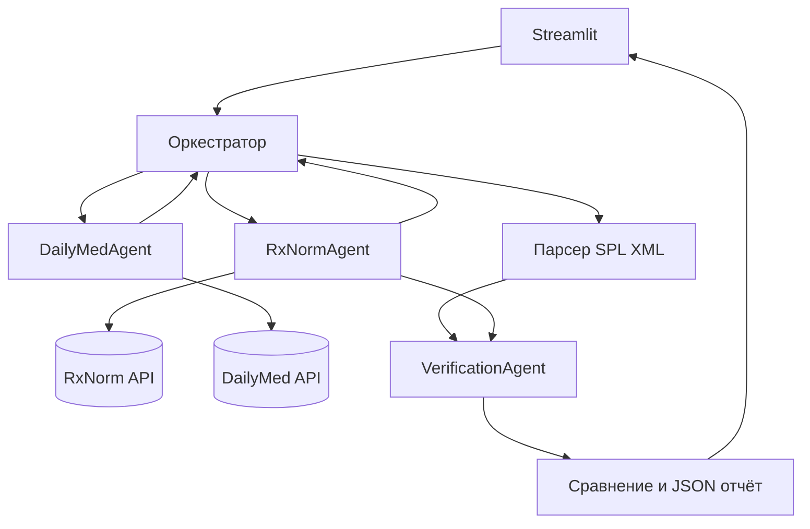

# DrugLens: RxNorm × DailyMed

**Мультиагентный веб-сервис для поиска и объяснимого сравнения официальных лекарственных инструкций США.**

Проект сделан как отдельный вариант предоставленного пользователем учебного проекта ПИМИМ: используется идея раздельных агентов-источников, оркестратора, проверки и веб-панели. Старый проект посвящён публикациям (PubMed + DailyMed), новый — идентификации и сопоставлению конкретных лекарственных продуктов (RxNorm + DailyMed).

## Что умеет

- Ввод одного либо двух лекарственных названий (рекомендуются английские названия рынка США).
- `RxNormAgent`: поиск продуктов и стандартных понятий, поиск ингредиентов по выбранному RxCUI.
- `DailyMedAgent`: поиск SPL-инструкций по RxCUI; при отсутствии результата видимое переключение на менее точный поиск по названию.
- Парсинг XML по официальным кодам LOINC: показания, противопоказания, предупреждения, нежелательные реакции, взаимодействия, дозирование, boxed warnings и типовые предупреждения OTC (безрецептурных лекарств).
- `VerificationAgent`: сравнение **точных RxCUI** действующих веществ, статусов доступности/буквального совпадения разделов инструкций; никаких выдуманных клинических интерпретаций.
- Оригинальные английские выдержки, ссылки на оригинал DailyMed, скачивание машиночитаемого JSON-отчёта.
- Независимые сообщения об ошибках источников, повторные запросы при временных ошибках, кеш Streamlit на 30 мин.

### Быстрый старт

Нужен Python 3.10+.

```bash
python -m venv .venv
# Windows:
.venv\Scripts\activate
# macOS/Linux: source .venv/bin/activate
pip install -r requirements.txt
streamlit run streamlit_app.py
```

Откройте `http://localhost:8501`. Попробуйте `Advil` и `Motrin`. После поиска выберите конкретную дозировку / форму и саму инструкцию SPL.

### Публикация

1. Загрузите **содержимое этой папки**, без старого проекта и без `.venv`, в GitHub-репозиторий.
2. Откройте [Streamlit Community Cloud](https://share.streamlit.io/).
3. Выберите репозиторий, ветку и точку входа `streamlit_app.py`. Зависимости будут установлены из `requirements.txt`.
4. Запустите приложение. API RxNorm/DailyMed публичны; платный LLM и токены для обычного поиска **не нужны**.

Если нужен повышенный лимит RxNav, опциональный `UMLS_API_KEY` можно задать через переменные окружения (не коммитить ключ в репозиторий).

### Структура

```text
streamlit_app.py           — интерфейс
requirements.txt           — зависимости
.streamlit/config.toml     — тема
  druglens/client.py       — API-клиент с retry, timeout
  druglens/rxnorm_agent.py — поиск RXCUI, форм и ингредиентов
  druglens/dailymed_agent.py — поиск SPL, XML / LOINC
  druglens/coordinator.py  — оркестрация и проверка
  tests/                   — офлайн-тесты с имитацией ответов API
  ДОКЛАД.md                — тезисы для защиты
```

## Архитектура



Агенты поиска независимы и могут выполняться параллельно. Это **не имитация врачебного консилиума**: отдельные роли имеют явные вызовы, выходные данные и правила проверки. Отсутствие результата API и отсутствие данных в конкретном SPL показываются явно.

## Источники и контракты

- [RxNorm getDrugs](https://lhncbc.nlm.nih.gov/RxNav/APIs/api-RxNorm.getDrugs.html): `GET https://rxnav.nlm.nih.gov/REST/drugs.json?name=...`
- [RxNorm getRelatedByType](https://lhncbc.nlm.nih.gov/RxNav/APIs/api-RxNorm.getRelatedByType.html): `GET /REST/rxcui/{rxcui}/related.json?tty=IN+PIN+MIN`
- [DailyMed v2 SPL search](https://dailymed.nlm.nih.gov/dailymed/webservices-help/v2/spls_api.cfm): `GET /dailymed/services/v2/spls.json?rxcui=...` либо `?drug_name=...`
- [DailyMed SPL XML](https://dailymed.nlm.nih.gov/dailymed/app-support-web-services.cfm): `GET /dailymed/services/v2/spls/{SETID}.xml`
- [FDA SPL LOINC section references](https://www.fda.gov/drugs/fdas-labeling-resources-human-prescription-drugs/selection-appropriate-spl-codes-human-prescription-drug-labeling)

## Ограничения и честная проверка

- Если несколько продуктов относятся к одному действующему веществу, это **не делает их взаимозаменяемыми**: важны дозировка, путь введения, форма, производитель и показания.
- DailyMed содержит **маркировку, представленную компаниями**; её содержимое не обязательно проверено FDA и может отличаться от последней FDA-approved инструкции. DailyMed описывает главным образом **продукты американского рынка**. Названия из России могут не найтись.
- При поиске по названию приложение честно пишет «по названию», а не заявляет о точном RxCUI-сопоставлении.
- Разные или отсутствующие текстовые разделы не означают сравнительную эффективность или безопасность: это **только сопоставление документации**.
- API обновляются, поэтому разработчик должен периодически перепроверять контракты и корректность классификаций.

### Тесты

```bash
python -m unittest discover -s tests -v
python -m compileall -q streamlit_app.py druglens
```

Тесты выполняются без интернета. **В текущей рабочей среде прямые сетевые обращения к rxnav.nlm.nih.gov и dailymed.nlm.nih.gov недоступны**, поэтому live end-to-end тест необходимо выполнить на устройстве или облачном хостинге с доступом к официальным API.

## Атрибуция NLM

This product uses publicly available data from the U.S. National Library of Medicine (NLM), National Institutes of Health, Department of Health and Human Services; NLM is not responsible for the product and does not endorse or recommend this or any other product.

